# Отчёт по лабораторной работе №2. Node-RED

**Студент:** Yaraslau Vauchkevich  
**Дисциплина:** Технологии визуального программирования  
**Тема:** Node-RED как low-code инструмент

---

## 1. Краткое описание выполненного

В ходе лабораторной работы №2 я освоил Node-RED как инструмент визуального программирования. Все задания выполнялись в локально запущенном контейнере Docker с официальным образом `nodered/node-red`.

В рамках работы были выполнены следующие задачи:

1. **Установка и запуск Node-RED** через Docker Desktop с монтированием volume (`node-red-data` → `/data`) и пробросом порта `1880:1880`.
2. **Собраны и задеплоены 12 базовых потоков** (2.1–2.12), охватывающих:
  - базовые ноды (inject, debug, function, switch, change, template),
  - работу с HTTP (http request, http in/response),
  - обмен сообщениями через MQTT с публичным брокером,
  - визуализацию через Dashboard 2.0 (gauge + chart),
  - интеграцию с Telegram через бота,
  - работу с файлами (чтение/запись),
  - работу с контекстом (flow context с сохранением между перезапусками).
3. **Выполнена ачивка №16** — Subflow для работы с файлами. Созданы два переиспользуемых subflow: `Save JSON to file` и `Read JSON from file`. Параметры (имя файла) передаются через `msg.filename`, что позволяет использовать эти subflow в разных потоках без дублирования логики.
4. **Оформлена документация API** в `lab2/docs/api.md` с описанием всех трёх GET-эндпоинтов, параметров, примеров успешных запросов и ошибок (400, 404).
5. **Сделан ряд коммитов** с осмысленными сообщениями в репозиторий.

---


## 2. Использованные AI-промпты (ключевые примеры)

При выполнении работы активно использовался AI-ассистент для генерации кода, объяснения нод и поиска ошибок. Ниже приведены несколько ключевых промптов (не дословно, но по сути):

1. **Генерация кода для Function node**
  > «Напиши код для Function node в Node-RED, который использует let/const, if/else, цикл for, массив и объект. Функция должна брать число из msg.payload и умножать его на элементы массива.»
2. **Генерация Mustache-шаблона для Template node**
  > «Сгенерируй Mustache-шаблон для Node-RED, который формирует JSON из входящего объекта с полями name, surname, group.»
3. **Поиск публичного API для HTTP Request**
  > «Какие есть публичные API без регистрации и токенов для Node-RED? Нужны простые, возвращающие JSON.»
4. **Генерация кода для GET-эндпоинта с path-параметром**
  > «Напиши код для Function node в Node-RED, который обрабатывает GET /api/items/:id, проверяет параметр id на число, возвращает 400 при ошибке, 404 если товар не найден, и 200 с JSON при успехе.»
5. **Помощь с subflow для ачивки 16**
  > «Помоги сделать subflow в Node-RED для сохранения и чтения JSON-файла, чтобы параметры (путь, имя файла) передавались через msg, а не хардкодились.»
6. **Диагностика проблемы с серыми нодами subflow**
  > «В subflow Node-RED нет серых нод input и output, как их добавить?»


## 3. Освоенные ноды

В ходе работы были освоены следующие ноды Node-RED:

### Базовые ноды

- **inject** — генерация сообщений (по кнопке, по интервалу, с JSONata-выражениями).
- **debug** — вывод сообщений в боковую панель (режимы `msg.payload` и `complete msg object`).
- **function** — написание JavaScript-кода для обработки сообщений.
- **switch** — ветвление потока по условию (`msg.payload`).
- **change** — модификация свойств сообщения (`Set msg.topic`, `Set msg.timestamp` через `$now()`, `Set msg.payload`).
- **template** — формирование текста или JSON через Mustache-шаблоны.


### Сетевые ноды

- **http request** — выполнение GET-запросов к публичным API (`catfact.ninja`, `official-joke-api`).
- **http in** — приём HTTP-запросов (создание REST-эндпоинтов).
- **http response** — отправка HTTP-ответов с нужным статусом и телом.
- **mqtt in / mqtt out** — публикация и подписка на сообщения через публичный MQTT-брокер (`broker.hivemq.com:1883`).


### Ноды для работы с файлами и контекстом

- **file in (read file)** — чтение файлов.
- **file out (write file)** — запись файлов.
- **flow context** (`flow.get()`, `flow.set()`) — хранение переменных между сообщениями с сохранением в файл через `localfilesystem`.


### Ноды Dashboard 2.0

- **ui-gauge** — прибор для отображения числового показателя.
- **ui-chart** — линейный график для истории значений.


### Ноды Telegram

- **telegram receiver** — приём сообщений от пользователя.
- **telegram command** — обработка команд (`/start`, `/help`) с регистрацией на сервере Telegram.
- **telegram sender** — отправка ответов пользователю.


### Subflow

- Созданы и использованы два переиспользуемых subflow: **Save JSON to file** и **Read JSON from file**.


## 4. Способ установки, версии Node-RED и Node.js

**Способ установки:** Docker (образ `nodered/node-red`)

**Команда запуска:**

```bash
docker run -d --name mynodered -p 1880:1880 -v "$(pwd)/node-red-data:/data" nodered/node-red
```

**Параметры:**

- Порт: `1880:1880`
- Volume: `node-red-data` (на хосте) → `/data` (в контейнере)

**Версии (из логов** `docker logs mynodered`**):**

- Node-RED: `v5.0.7` (версия может отличаться в зависимости от образа; указывается из вывода логов)
- Node.js: `v24.20.0` (или фактическая версия из логов)

**Дополнительно установленные пакеты:**

- `@flowfuse/node-red-dashboard` — Dashboard 2.0
- `node-red-contrib-telegrambot` — для Telegram-бота

---


## ## 5. Скриншоты всех flow

### 2.1. Inject → Debug

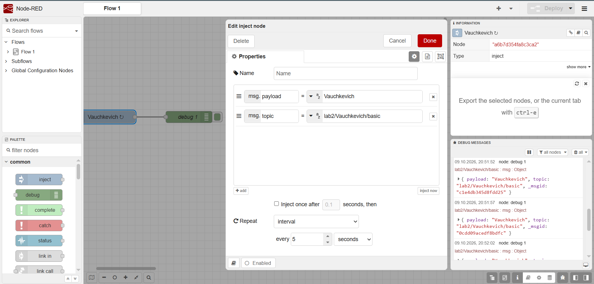

### 2.2. Function node

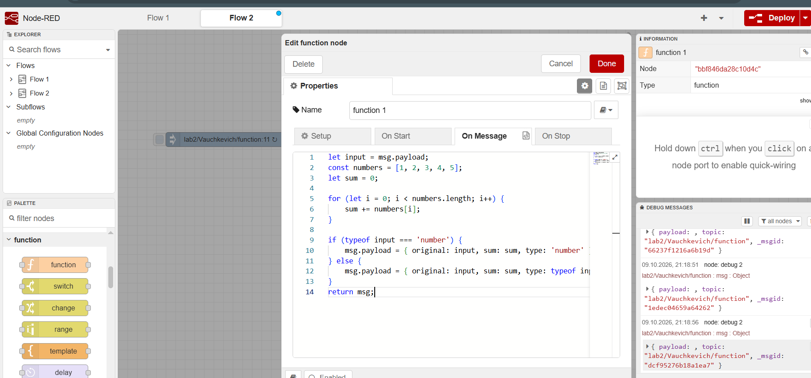

### 2.3. Switch node

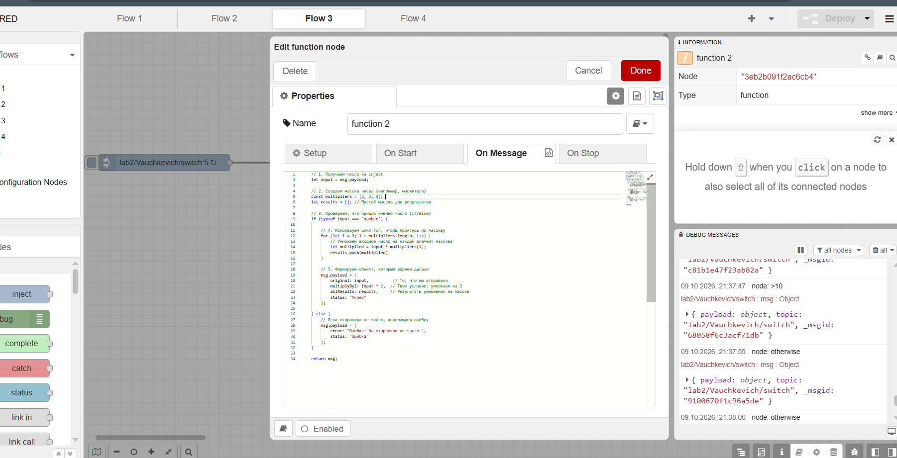

### 2.4. Change node

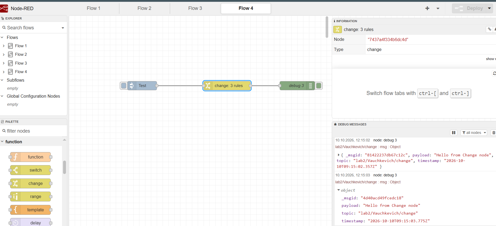

### 2.5. Template node

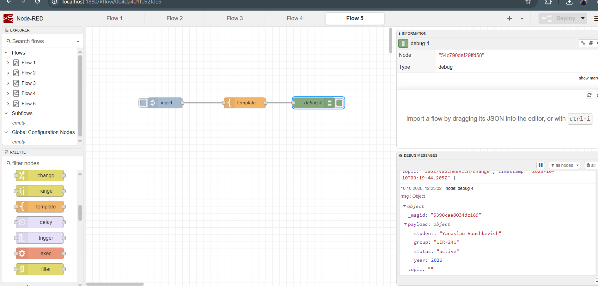

### 2.6. HTTP Request

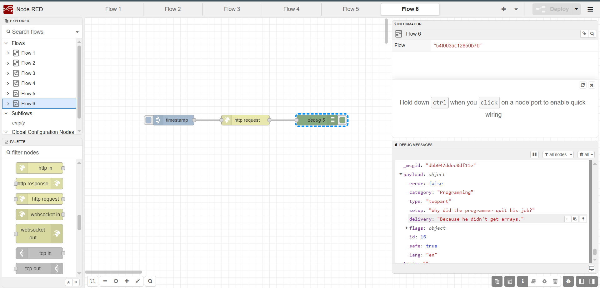

### 2.7. MQTT

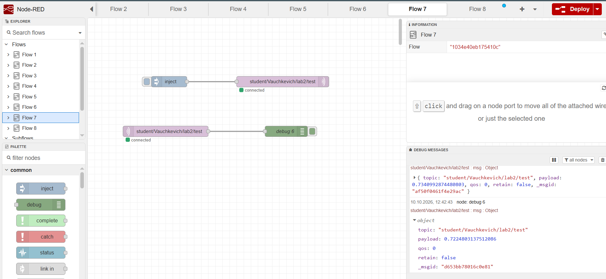

### 2.8. GET-эндпоинты

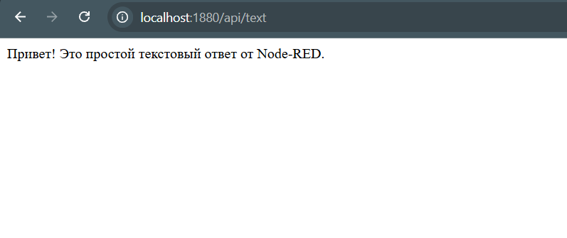

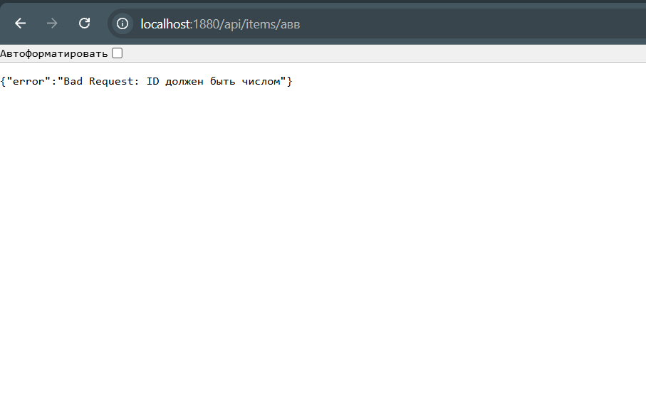

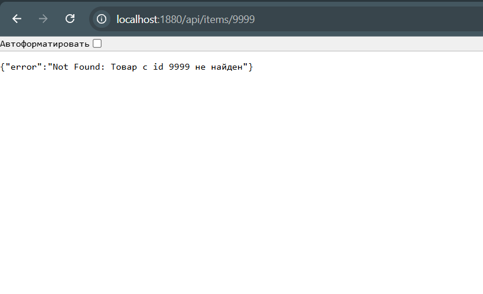

### 2.9. Dashboard

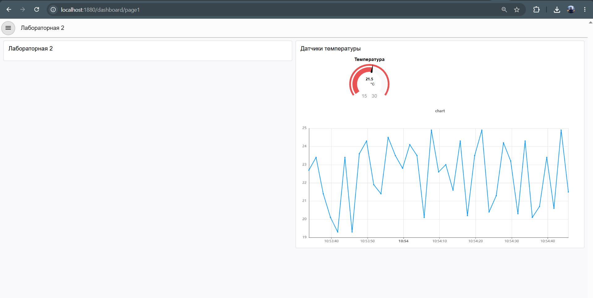

### 2.10. Telegram-бот

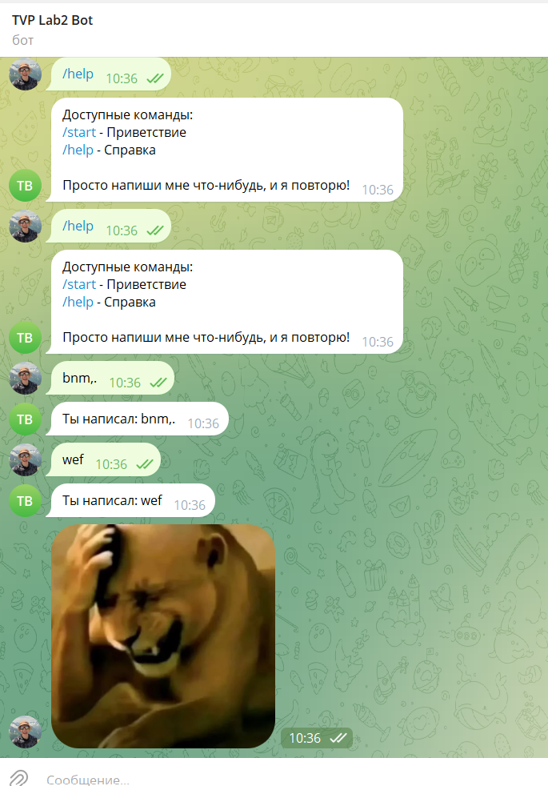

### 2.11. Работа с файлами

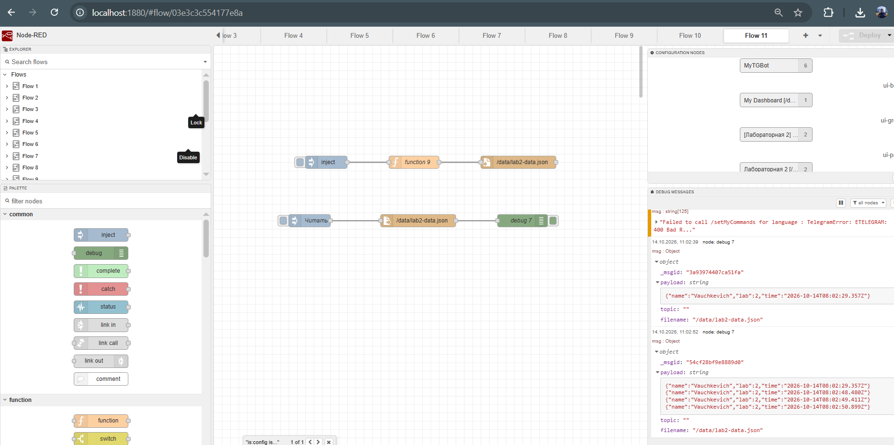

### 2.12. Контекст

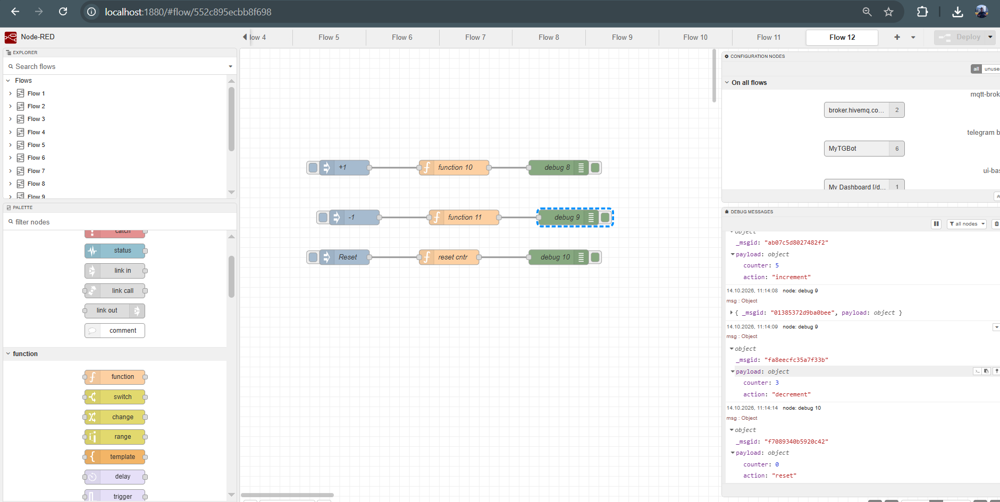

### Ачивка 16. Subflow

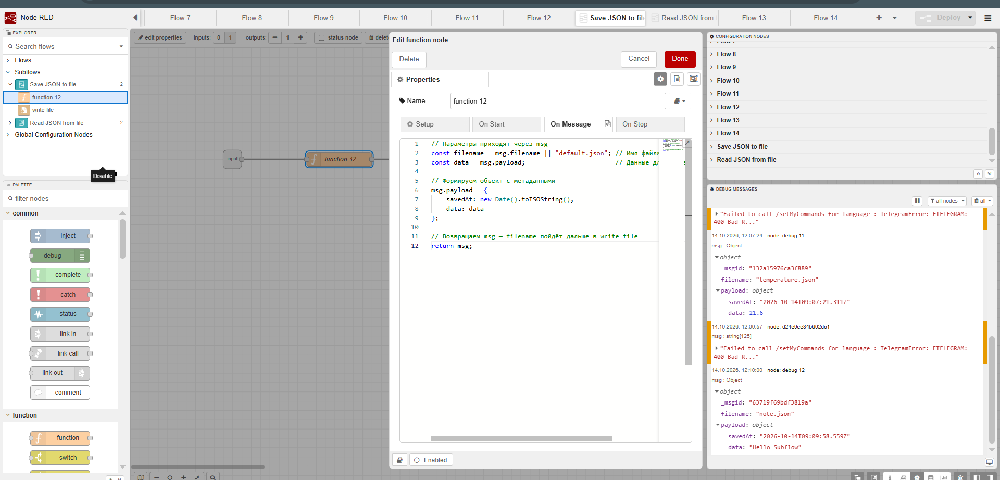

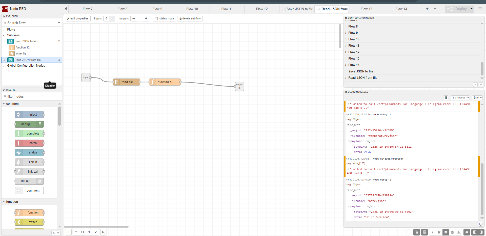

## **6. Выводы**

Работать в node red понравилось, было удобно обрабатывать команды в тг боте. Также я впервые использовал докер контейнер, и мне тоже понравилось)) Раньше я писал тг ботов на питоне и запускал локально хоть их можно было проще сделать визуально через нод ред