Лабораторная работа №3. Bubble  
**Тема:** Система интеллектуальной поддержки стартап-проектов на ранней стадии (прототип)  
**Студент:** Волчкевич Ярослав  
**Дисциплина:** Технологии визуального программирования  

---

## 1. Краткое описание выполненного

В рамках лабораторной работы было создано no-code веб-приложение «StartupSupport» на платформе Bubble.  
Приложение представляет собой платформу для стартапов с двумя ролями: «Основатель» и «Специалист».  
В ходе работы были выполнены следующие задачи:  

- Сгенерирован каркас приложения с помощью AI-агента (с сохранением структуры header + body + footer и обязательной метки «ТВП: Волчкевич»).  
- Проведено исследование Build Guides и внедрена идея карточек проектов.  
- Вручную доработан UI (создана глобальная переменная цвета, стилизованы кнопки, добавлены компоненты).  
- Спроектирована база данных (Data Types: `Project`, `Комментарий`, `User`).  
- Реализован полный CRUD (Create, Read, Update, Delete) для страницы `comments-crud` с разделением прав (админ может одобрять комментарии, пользователь — только оставлять свои).  
- Установлен и настроен плагин **Full Calendar** для визуализации дедлайнов проектов, реализованы воркфлоу клика по событию и клика по дню.

---


## 2. Промпт для генерации каркаса (Часть 1, дословно)

```text
Создай приложение на тему «Система интеллектуальной поддержки стартап-проектов на ранней стадии» (прототип). Пусть этот сайт будет требующим регистрацию (с упрощённой авторизацией: роль «Основатель» или «Специалист» при регистрации). Обязательно укажи в заготовке следующую строку: «ТВП: Волчкевич» Страницу обязательно создай по структуре header + body + footer. Обязательно укажи в заготовке следующую строку: «ТВП: <Фамилия>» (в подвале или в шапке сайта, отдельным текстовым элементом). Добавь несколько интерактивных элементов, реализующих CRUD. Расширенное описание темы Приложение — веб-платформа для основателей стартапов и специалистов, желающих присоединиться к проекту. Платформа объединяет три функции: Проверка идеи — основатель вводит описание идеи, система показывает список уже существующих аналогов/конкурентов (по заранее подготовленной базе данных). Верификация названия — основатель вводит название стартапа, система проверяет, занято ли оно: товарные знаки, домены, существующие компании/бренды (по базе данных). Командообразование — основатель публикует заявку на участие в проекте (описание, нужные роли), специалисты видят заявки и откликаются с предложением помощи. Роли пользователей Основатель (founder) — создаёт проект, проверяет идею и название, публикует заявку на команду. Специалист (contributor) — просматривает ленту заявок, откликается на них. Функционал MVP (с CRUD) Регистрация/вход (упрощённо, на встроенной авторизации Bubble). Create: создание проекта (название, описание идеи, нужные роли), создание отклика на заявку. Read: лента проектов/заявок; страница проекта; список аналогов по идее; результаты проверки названия; список моих откликов. Update: редактирование своего проекта (название, описание, роли); редактирование профиля. Delete: удаление своего проекта; удаление своего отклика. Проверка идеи: поиск по базе аналогов (Data Type «Аналог»). Проверка названия: поиск по базе названий/доменов (Data Type «Название»). Структура страниц (header + body + footer на каждой) Header: логотип, название приложения, навигация (Главная, Проекты, Проверка идеи, Проверка названия, Профиль), кнопки Вход/Регистрация или Выход. Строка «ТВП: <Фамилия>». Body: основной контент страницы. Footer: краткое описание проекта, контакт, строка «ТВП: <Фамилия>».
```


## **3. [Ссылка на dev-версию приложения](https://startupsupport.bubbleapps.io/version-test/dashboard?debug_mode=true)**

---


## **4. Использованные AI-промпты (дословно)**


### **4.1. Промпт для новой сущности (Data Type)**

*Примечание: AI сообщил, что сущность* `Project` *уже есть, поэтому я попросил расширить её поля.*

а придумай поля для нового типа данных

*Дополнительный контекст, который я давал для проектов:*

Предложи структуру Data Type для приложения «Система интеллектуальной поддержки стартап-проектов на ранней стадии» — платформы, где основатель создаёт проект, проверяет идею и название, публикует заявку на команду, а специалист просматривает ленту проектов и откликается на них. Мне нужна новая сущность для хранения стартап-проектов, которые создаёт основатель. Нужно: - осмысленное название сущности; - минимум 3 поля разных типов (текст, дата, да/нет, список текстов, ссылка на User и т.п.); - для каждого поля — краткое пояснение назначения. Учти: - основатель должен видеть и редактировать только свои проекты (фильтр по Current User); - специалист видит проекты в общей ленте и может откликаться, но не редактирует чужие проекты; - в проекте нужно хранить как минимум: название, описание идеи, требуемые роли, статус, дату создания и автора. Выведи итоговую таблицу: название поля → тип → назначение.

### **4.2. Промпты для страницы CRUD (Часть 4.2)**

Создай новую страницу "comments-crud". Структура: header + body + footer (header и footer скопируй с главной). В body размести: 1. Форму создания комментария: - Input "Текст комментария" (multiline). - Checkbox "Полезен ли комментарий". - Кнопка "Оставить комментарий". 2. Repeating Group для списка комментариев. - Type of content: Комментарий. - Data source: Do a search for Комментарий. 3. В каждой ячейке Repeating Group покажи: - Текст комментария. - Галочку, если "Полезен". - Кнопки "Редактировать" и "Удалить". - Текст "Роль: [роль пользователя]".

Обнови страницу "comments-crud". В форме создания комментария скрой Checkbox "Полезен ли комментарий" по умолчанию. Настрой условную видимость для этого Checkbox: показывать его только если Current User's is_admin is "yes". В Repeating Group (список комментариев) рядом с текстом комментария добавь отображение статуса: - Если комментарий полезен, покажи зеленую иконку или текст "Одобрено админом". - Если не полезен, покажи серый текст "На модерации".

Создай workflow для кнопки "Оставить комментарий". Event: When Button "Оставить комментарий" is clicked. Action 1: Create a new thing, Type = Комментарий. Поля: - Текст комментария = Input "Текст комментария"'s value - Автор = Current User - роль пользователя = Current User's роль (если такого поля нет в User, оставь пустым или удали этот маппинг) - Полезен ли комментарий = no (по умолчанию ставим "нет", чтобы админ потом проверил) Action 2: Reset inputs (сбрось значение Input "Текст комментария"). Action 3: Show a message (покажи всплывающее уведомление "Комментарий отправлен на модерацию").

Создай workflow для кнопки "Удалить" внутри Repeating Group. Шаг 1. Добавь условную видимость для кнопки "Удалить": показывать её только если Current User is Current cell's Комментарий's Автор ИЛИ Current User's is_admin is yes. Шаг 2. Настрой workflow для кнопки "Удалить": Event: When Button "Удалить" is clicked. Action 1: Show Popup "delete-confirm". Action 2: Display data → Popup "delete-confirm", Data to display = Current cell's Комментарий. Шаг 3. Внутри Popup "delete-confirm" настрой кнопку "Да, удалить": Event: When Button "Да, удалить" is clicked. Action 1: Delete a thing, Thing to delete = Popup "delete-confirm"'s Комментарий. Action 2: Hide Popup "delete-confirm".

### **4.3. Промпт для плагина Full Calendar (Часть 5)**

Я установил плагин "Full Calendar". Мне нужно настроить его для отображения проектов. Выполни следующие шаги: 1. РАБОТА С БАЗОЙ ДАННЫХ: В Data Type "Project" создай новое поле: - Name: "Дата презентации" - Type: date Создай 3 тестовые записи в App Data для "Project" (если их нет), заполнив поля "Название", "Описание" и установив разные даты в поле "Дата презентации" (например, сегодня, завтра и через неделю), чтобы на календаре появились события. 2. СОЗДАНИЕ СТРАНИЦЫ И UI: Создай новую страницу "calendar". Структура страницы: header + body + footer (header и footer скопируй с главной страницы, чтобы сохранить единый стиль). В body размести элемент плагина "Full Calendar". 3. НАСТРОЙКА КАЛЕНДАРЯ: Настрой элемент "Full Calendar" следующим образом: - Type of events: Project - Data source: Do a search for Project - Start time field: Дата презентации - Event caption: Current event's Название - Available views: Month only - Event color: выбери приятный синий цвет. 4. НАСТРОЙКА POPUP И WORKFLOW: На этой же странице создай Popup и назови его "project-details". Внутри Popup размести текстовый элемент для вывода Названия проекта. Настрой workflow для календаря: - Event: A calendar's event is clicked. - Action 1: Show Popup "project-details". - Action 2: Display data → Popup "project-details", Data to display = This calendar's current event.

## **5. Освоенные элементы и workflows**

**Элементы (UI/Design):**

- `Repeating Group` для вывода списков проектов и комментариев.
- `Input`, `Multiline Input`, `Date Picker` для форм создания.
- `Popup` для всплывающих окон (создание, редактирование, удаление, детали).
- `Checkbox` с условной видимостью (Conditional formatting) для роли администратора.
- `Full Calendar` (плагин) с настройкой Data Source и Event Caption.
- Создание Global Variable (для цвета) и Style.

**Workflows (Логика):**

- `Create a new thing` (создание записей в БД).
- `Make changes to a thing` (обновление записей).
- `Delete a thing` (удаление записей).
- `Display data` (передача контекста текущей ячейки в Popup).
- `Show` / `Hide` (управление модальными окнами).
- `Reset inputs` (очистка форм).
- Условные выражения (Conditionals) для скрытия/показа кнопок на основе `Current User` или `is_admin`.

---


## **6. Скриншоты шагов**

***Все скриншоты находятся в папке*** `lab3/screenshots/` ***согласно структуре. Ссылки относительные, поэтому картинки будут отображаться прямо в Markdown.***

**Часть 1. Промпт и генерация каркаса**

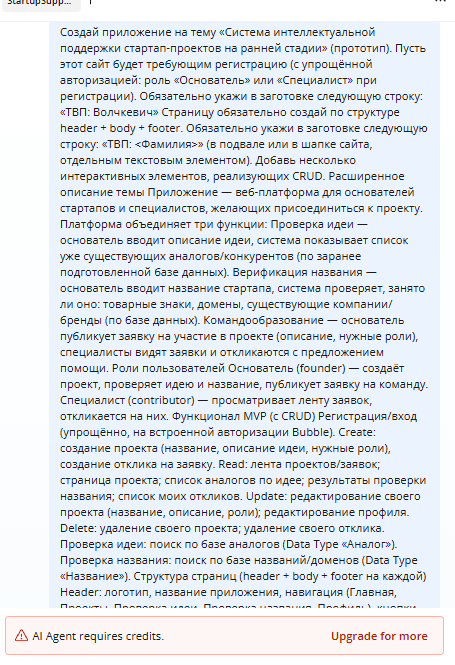

**Часть 2. Исследование идеи (Build Guides)**

**Изучение гайдов:**

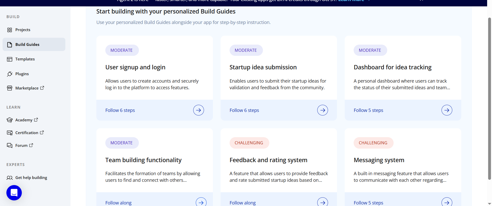

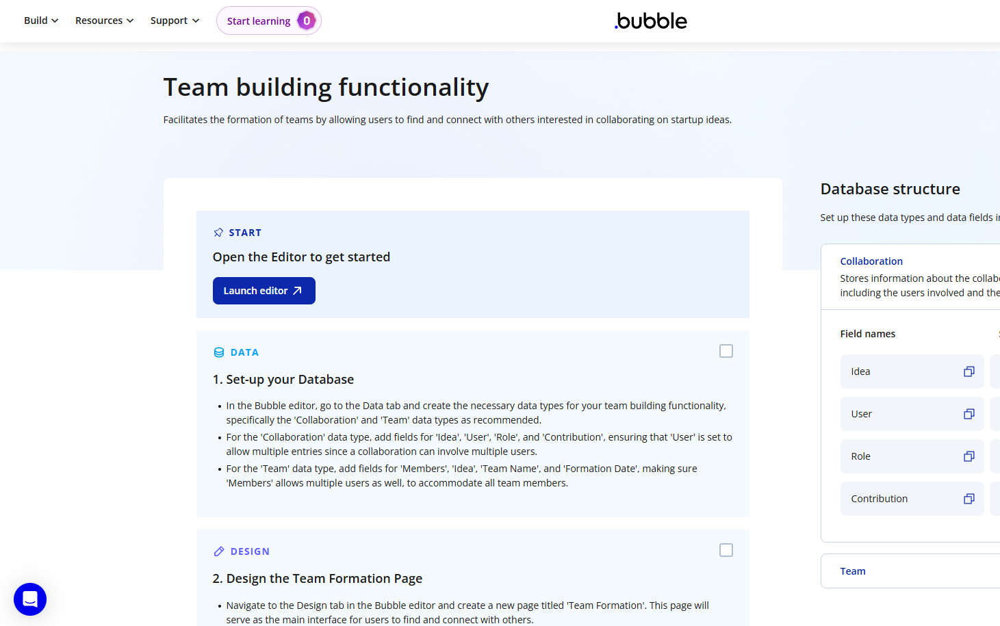

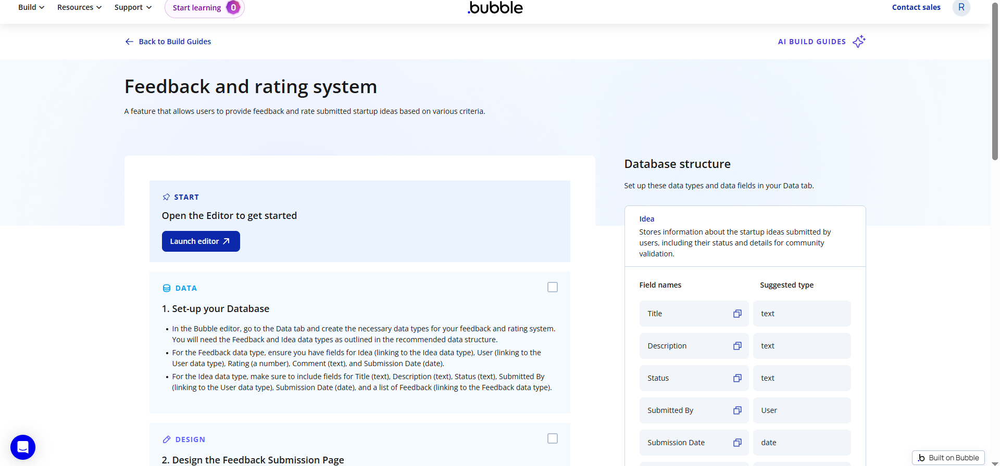

**Часть 3. Ручная доработка UI**

**Изменение заголовка, создание переменной, стиля и добавление компонента:**

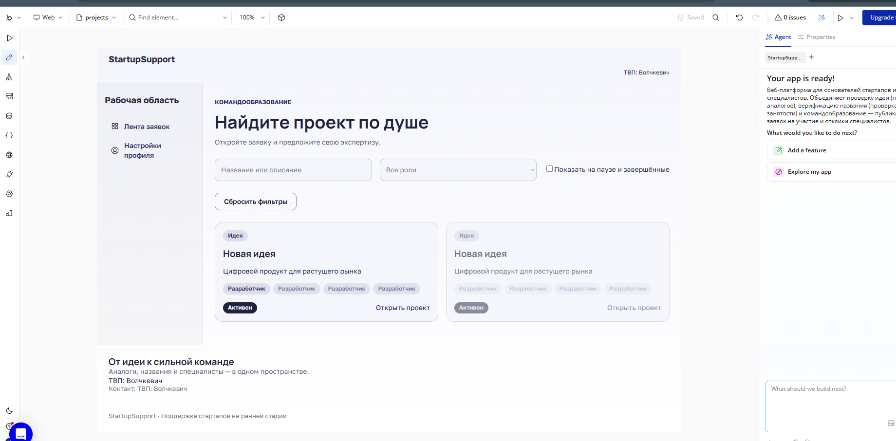

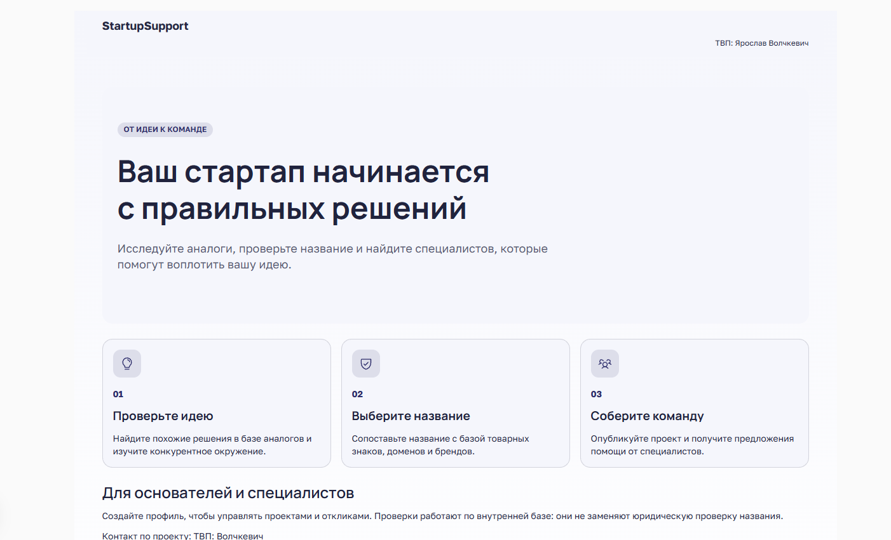

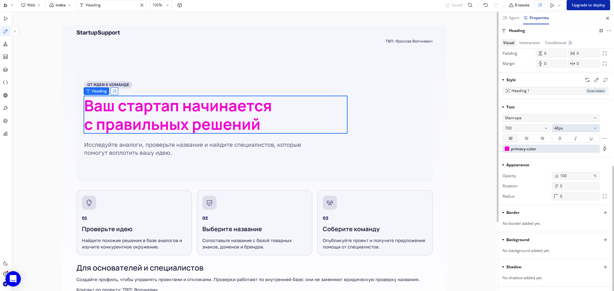

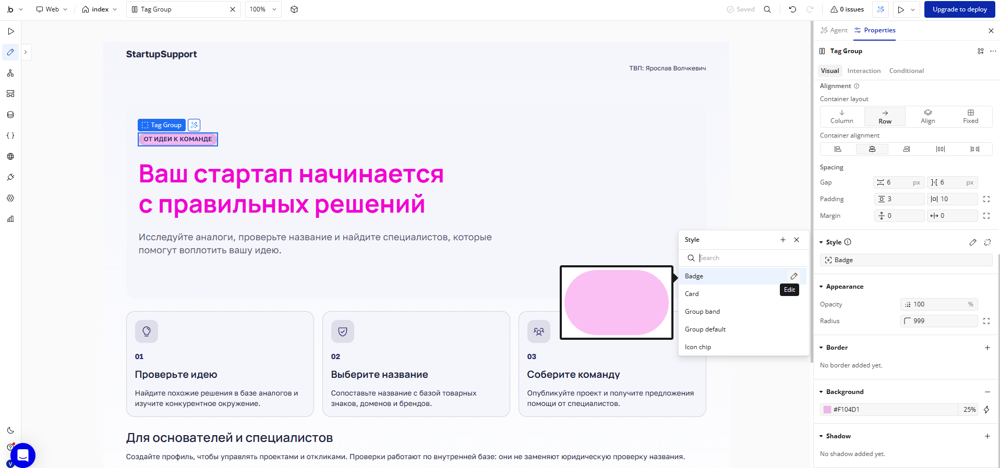

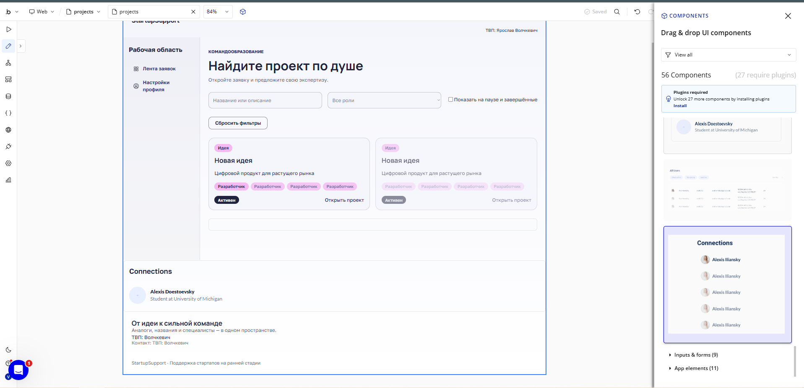

**Часть 4. Data и Workflows (CRUD)**

**Создание сущности, заполнение базы, настройка воркфлоу:**

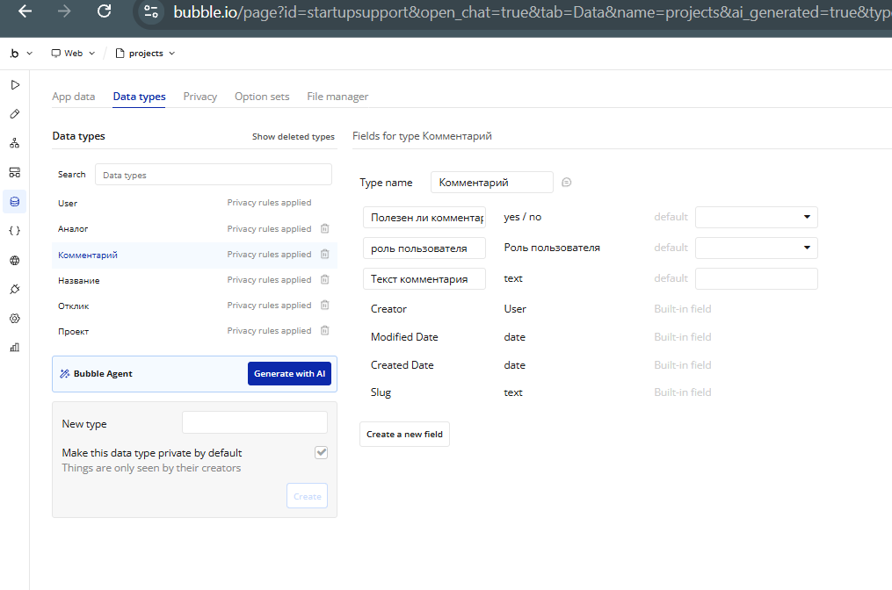

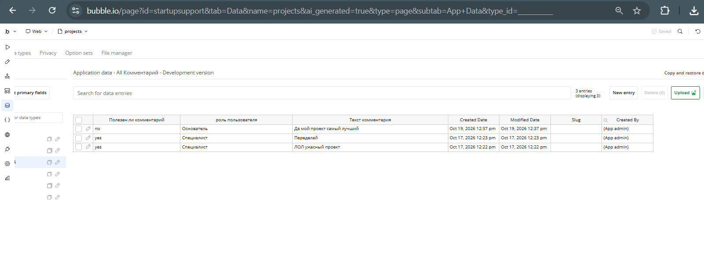

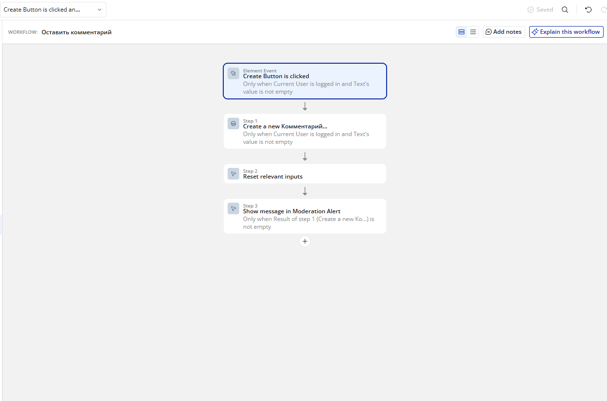

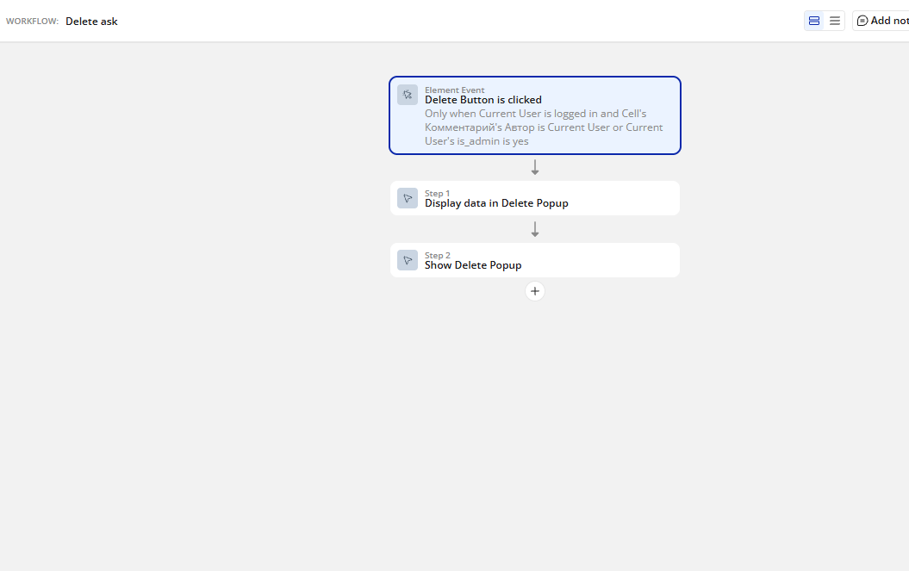

**Часть 5. Ачивка 2. Plugins (Full Calendar)**

**Демонстрация работы плагина:**

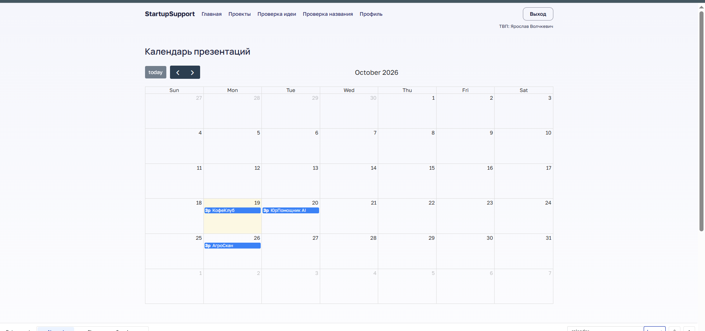

---


## **7. Выводы**

В ходе выполнения лабораторной работы я освоил базовые и продвинутые механики платформы Bubble. Использование AI-агента показало, что нейросеть отлично справляется с рутинной генерацией UI и базовых воркфлоу, однако она часто ошибается в деталях (например, при создании новых сущностей или настройке сложных условий видимости). Мне пришлось вручную исправлять ошибки Data Source у Repeating Group (когда вместо списка сущностей выбирался список текстов) и настраивать Privacy Rules.

 В целом, Bubble позволяет быстро создавать функциональные прототипы уровня MVP без написания кода, а комбинация AI-генерации и ручной доработки дает наилучший результат.