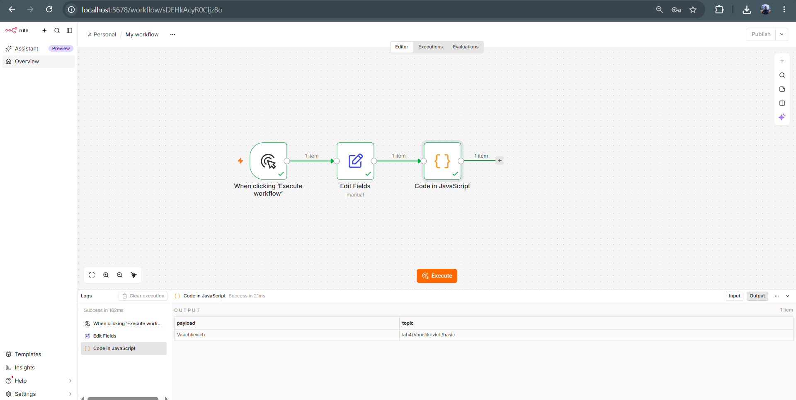
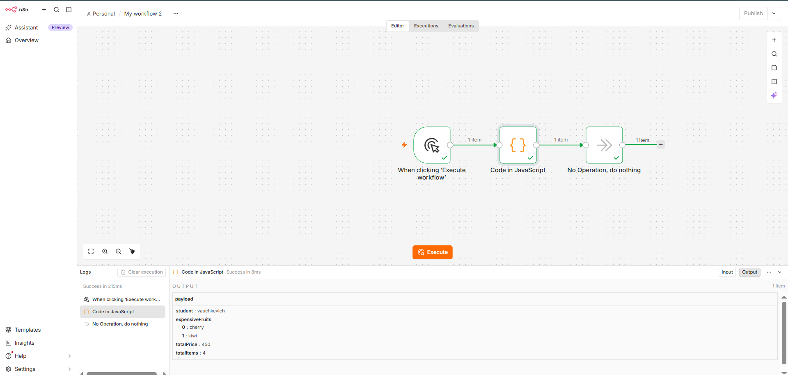
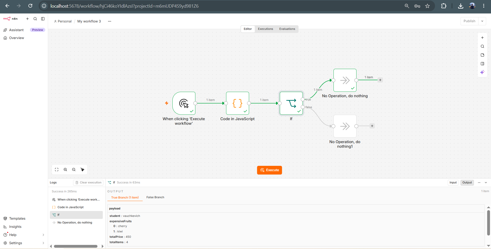
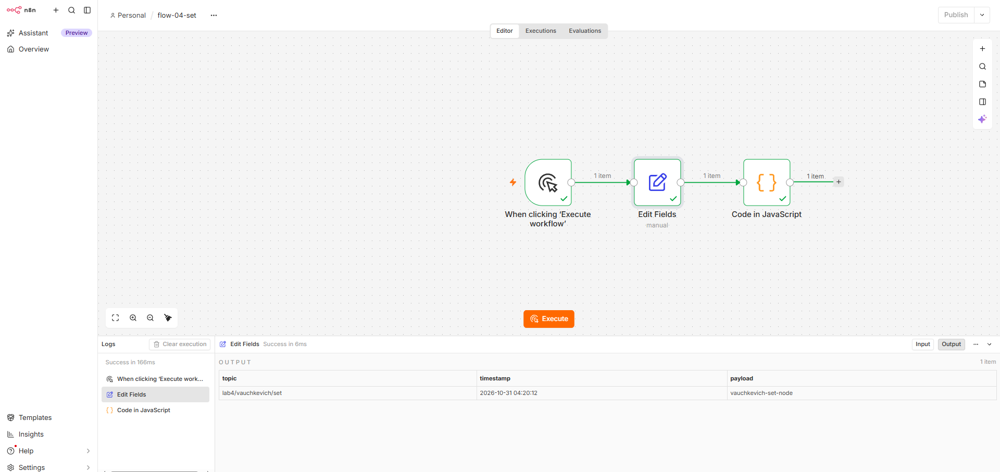
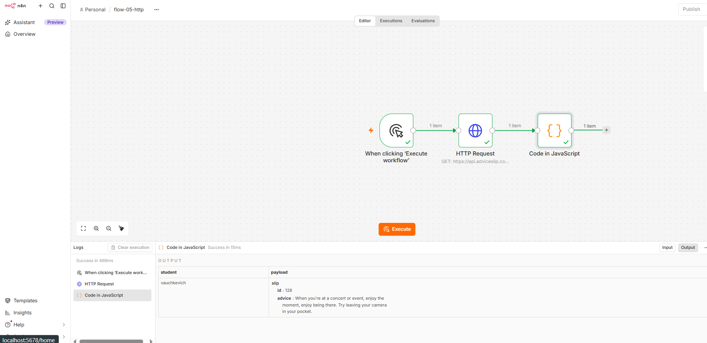
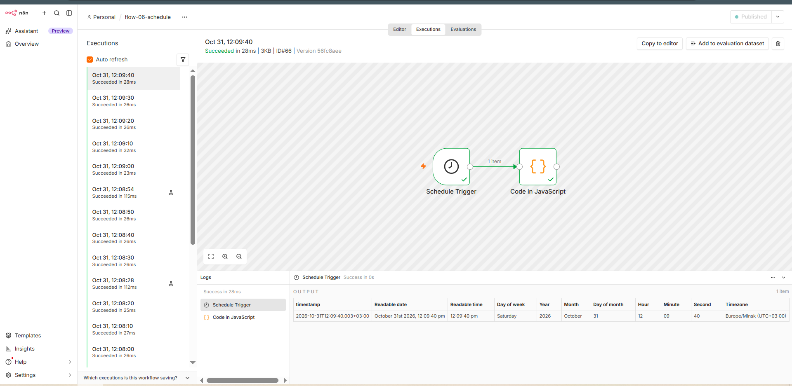
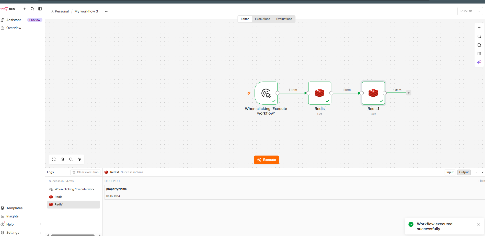
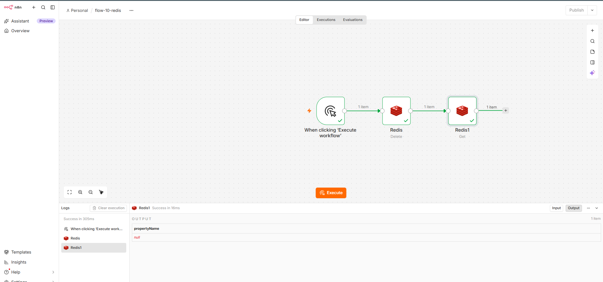
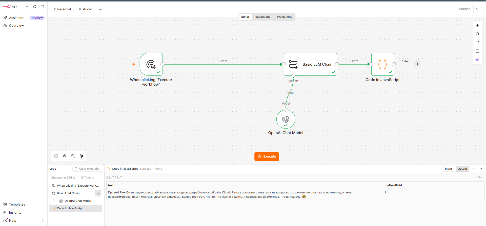

# Лабораторная работа №4. n8n

**Студент:** Волчкевич Ярослав

**Цель работы:** Освоить n8n как low-code платформу автоматизации: установить через Docker, изучить базовые и продвинутые ноды, настроить Redis и реализовать создание/удаление ключа, а также выполнить индивидуальную ачивку.

---

## 1. Краткое описание выполненного

В ходе лабораторной работы была развернута платформа n8n с использованием Docker. Были изучены и протестированы базовые ноды (Manual Trigger, Set, Code, IF, NoOp, HTTP Request, Schedule Trigger). 

Отдельно была настроена интеграция с Redis (через Docker) и собраны два workflow для записи/чтения и удаления/проверки ключей. Также была выполнена индивидуальная ачивка **1.2** — подключение локальной языковой модели через **LM Studio** и её использование в связке с нодой `Basic LLM Chain`.

---

## 2. Какие AI-промпты использовались

При выполнении работы использовались следующие ключевые промпты для генерации кода и решения проблем с интерфейсом:

1. *«Напиши JavaScript код для ноды Code в n8n. Нужно использовать let/const, if/else, цикл for, массив и объект. Функция должна возвращать объект с полем payload, где будет фигурировать фамилия vauchkevich»* — для пункта 2.2.
2. *«Почему нода Redis Get в n8n возвращает null, хотя ключ был записан?»* — для отладки взаимодействия с Redis.
3. *«В n8n при подключении LM Studio ошибка "Unexpected endpoint or method (POST /chat/completions)". Как исправить?»* — для решения проблемы с Base URL в OpenAI Credential.

---

## 3. Какие ноды освоены

В рамках работы были изучены и применены следующие ноды:

- **Manual Trigger** — ручной запуск workflow.
- **Set (Edit Fields)** — создание и изменение полей (payload, topic, timestamp).
- **Code** — выполнение кастомного JavaScript-кода (работа с массивами, объектами, циклами).
- **IF** — логическое ветвление (проверка `totalPrice > 400`).
- **NoOp (No Operation)** — заглушка для завершения веток.
- **HTTP Request** — выполнение GET-запросов к публичному API (Advice Slip API).
- **Schedule Trigger** — запуск workflow по расписанию (настроен на каждую минуту/5 минут).
- **Redis (Set, Get, Delete, Exists)** — операции с базой данных ключ-значение.
- **Basic LLM Chain + OpenAI Chat Model** — связка для работы с локальной языковой моделью.

---

## 4. Скриншоты всех workflow

### 4.1. Базовые и продвинутые ноды (Часть 2)

**2.1. Manual Trigger → Set → Code**

**2.2. Manual Trigger → Code → NoOp**

**2.3. Manual Trigger → Code → IF → NoOp (True/False)**

**2.4. Manual Trigger → Set → Code (complete msg object)**

**2.5. Manual Trigger → HTTP Request (Advice Slip API) → Code**

**2.6. Schedule Trigger → Code**

### 4.2. Redis (Часть 3)

**3.1. Создание и чтение ключа (Set → Get)**

**3.2. Удаление и проверка отсутствия (Delete → Exists)**

### 4.3. Ачивка 1.2 — LM Studio (Часть 4)

**Подключение локальной модели через LM Studio и OpenAI-совместимый API**

---

## 5. Выводы

В ходе лабораторной работы я научился разворачивать n8n в Docker и подключать к нему внешние сервисы, такие как Redis. Особенно полезным было понять, как работает нода Code и как передаются данные между нодами (в формате JSON). 

Настройка Redis показала, как важно следить за тем, чтобы все ноды использовали одни и те же Credentials и логические базы данных (иначе `Get` возвращает `null`). 

Подключение LM Studio (ачивка 1.2) дало понимание того, как low-code платформы интегрируются с локальными LLM. Главным инсайтом стало то, что n8n ожидает строго определенный формат URL (с `/v1` в конце) для OpenAI-совместимых API, иначе запросы уходят на несуществующие эндпоинты. В целом, n8n показал себя как мощный инструмент для быстрой автоматизации без написания сложного бэкенда.