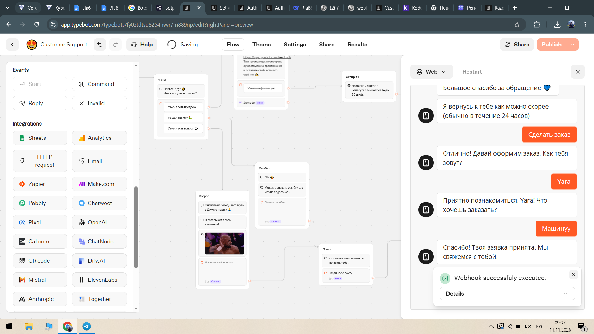
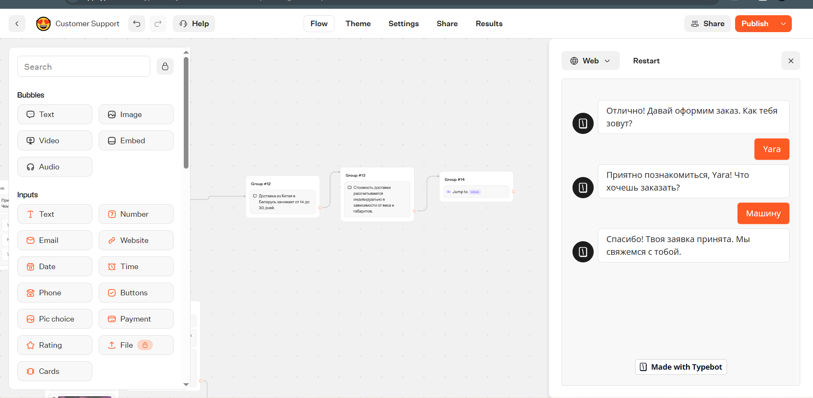
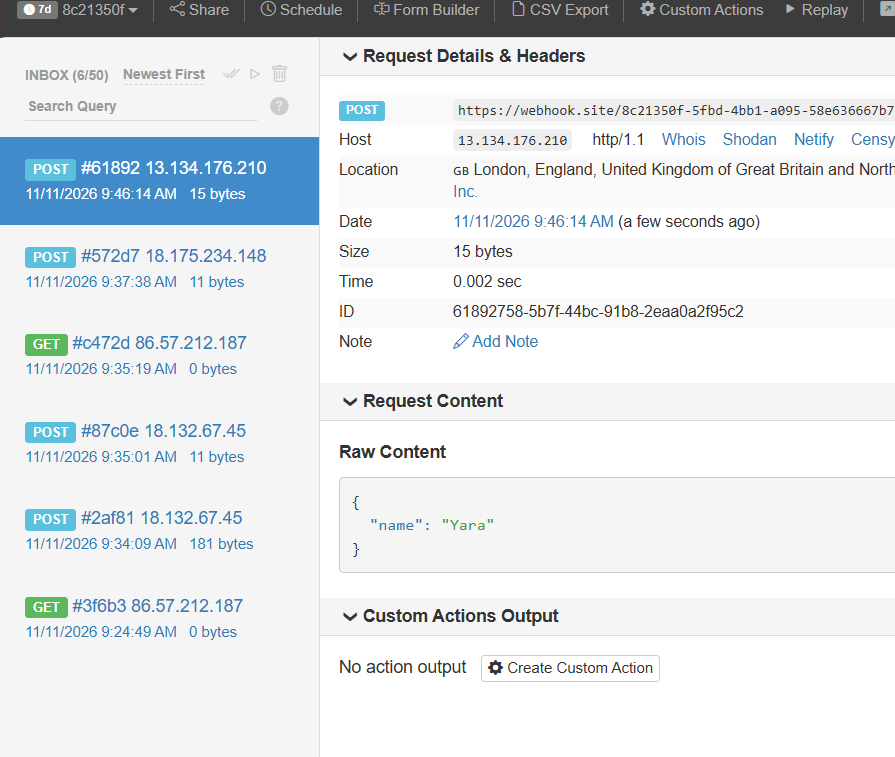

# Лабораторная работа №5. Чат-боты

**Трек:** C. TypeBot

**Студент:** <Фамилия Имя>, группа <Группа>

**Ссылка на бота:** <вставьте ссылку на опубликованный Web-бот>

**Исходный шаблон:** Customer Support (TypeBot Templates)

## 1. Краткое описание выбранного трека

Для выполнения лабораторной работы выбран трек C (TypeBot). За основу взят готовый шаблон «Customer Support», который был полностью русифицирован и доработан: добавлены два новых флоу («Заказ» и «Информация»), условие (Condition), переменные `Имя`, `Товар`), а также интеграция с внешним сервисом через HTTP Request. Изменён брендинг (иконка 🐼, название «PandaDo Lite»).

## 2. Ссылка на бота или flow

- **Ссылка на бота (Web):** <вставьте ссылку из TypeBot>

- **Экспорт JSON:** `exports/flow-01-pandado-lite.json`

- **Скриншоты:** папка `screenshots/`

## 3. Какие AI-промпты использовались

1. «Переведи все тексты и кнопки шаблона Customer Support на русский язык, сохранив структуру блоков».

2. «Как в TypeBot добавить условие (Condition) для проверки, что переменная не пустая?»

3. «Какой блок в TypeBot используется для отправки HTTP-запроса на внешний URL (не Webhook)?»

4. «Как вывести значение переменной в текстовом блоке TypeBot?»

## 4. Какие блоки/ноды/элементы освоены

- **Text** — вывод сообщений с поддержкой переменных `{{Имя}}`).

- **Choice input** — кнопки с переходами между группами.

- **Text input** — сбор данных в переменные `Имя`, `Товар`).

- **Email input** — сбор email (унаследован из шаблона).

- **Condition** — проверка, что переменная `Товар` не пустая; ветвление логики.

- **Jump** — возврат в главное меню.

- **HTTP Request** — отправка POST-запроса с данными заказа на внешний URL ([Webhook.site](http://Webhook.site)).

- **Variables** — создание и использование переменных `Имя`, `Товар`).

- **Theme / Branding** — смена иконки и названия бота.

## 5. Что изменено по сравнению с шаблоном (для защиты)

1. **Русификация:** все тексты, кнопки, плейсхолдеры и описания переведены с английского на русский.

2. **Добавлен флоу «Заказ»:**

   - Сбор имени `Имя`) и описания товара `Товар`).

   - Условие (Condition): если поле «Товар» пустое — бот просит повторить ввод и возвращает в начало группы.

   - При успешном заполнении — сообщение «Заявка принята».

3. **Добавлен флоу «Информация»:** текст о сроках доставки из Китая в Беларусь.

4. **Добавлен HTTP Request:** после сбора данных бот отправляет POST-запрос на [Webhook.site](http://Webhook.site) с JSON `{"name": "{{Имя}}", "item": "{{Товар}}"}`.

5. **Сменён брендинг:** иконка 🐼, название «PandaDo Lite».

6. **Проверка после перевода:** переменные и логика переходов не сломались (проверено в Preview).

## 6. Скриншоты

**Общий вид флоу и тестирование в чате:**

**Добавленные флоу (Заказ и Информация):**

**Настройка HTTP-запроса (Интеграция):**

## 7. Ограничения и выводы

В ходе работы освоен low-code инструмент TypeBot для построения чат-ботов. Понял(а), как работают группы блоков, переменные, условия и переходы между флоу. Отдельно разобрался(ась) с разницей между блоком **Webhook** (ожидание внешнего вызова) и **HTTP Request** (отправка данных наружу) — для лабораторной использовался именно HTTP Request.

**Ограничения TypeBot (в рамках бесплатного тарифа):**

- Ограниченное количество ботов и сообщений в месяц.

- Нет встроенной базы данных для хранения заказов между сессиями (переменные живут в рамках сессии/пользователя).

- Для реальной интеграции с Telegram требуется настройка токена и публикация бота.

**Вывод:** TypeBot позволяет быстро собрать рабочий сценарий без кода, но для полноценной системы (например, как в ТЗ PandaDo) потребовалась бы серверная часть с PostgreSQL и отдельной админ-панелью. В рамках лабораторной задачи функционал шаблона был успешно расширен и русифицирован.