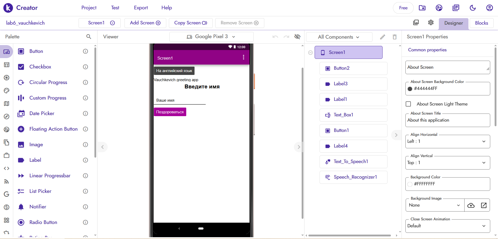
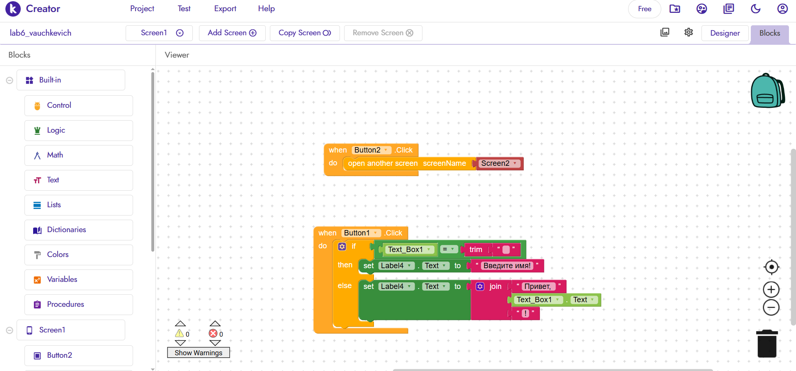
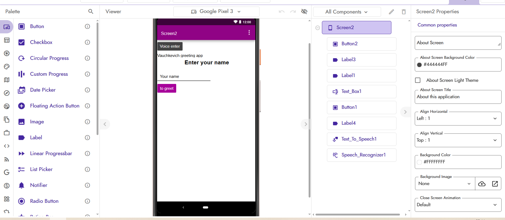
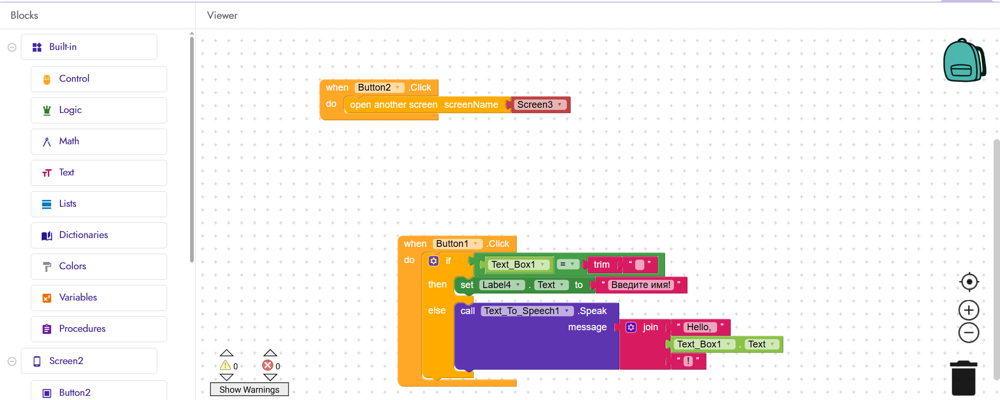
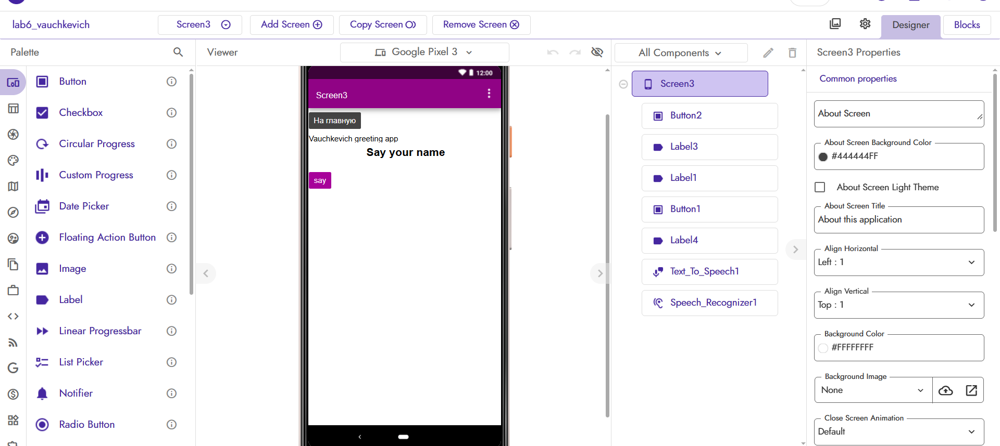
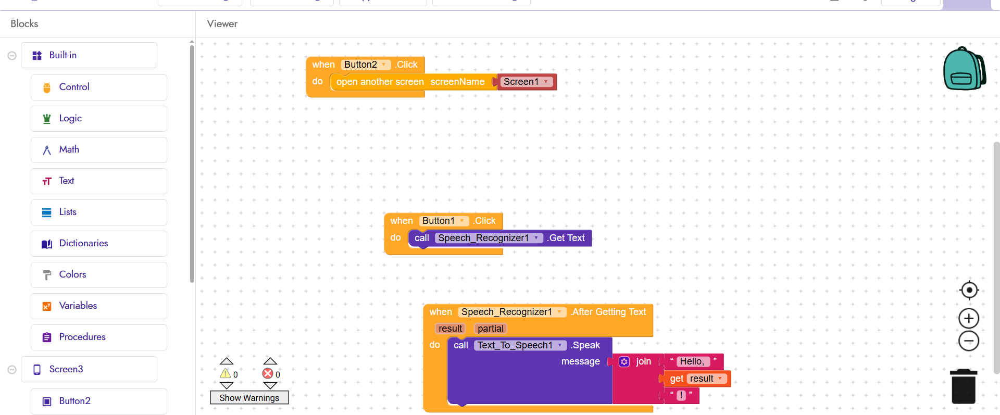
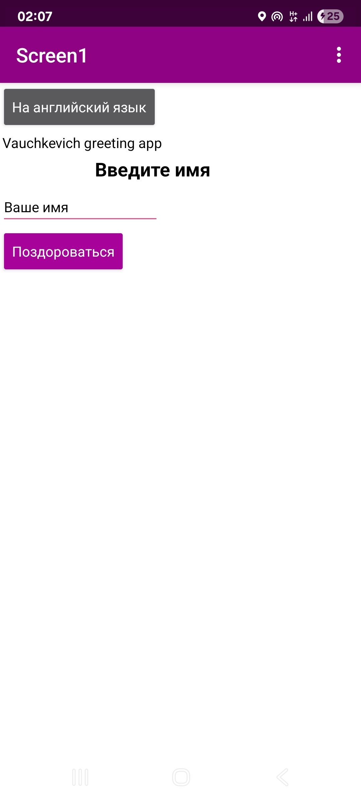

# Лабораторная работа №6. Kodular

**Студент:** Волчкевич  Ярослав  
**Группа:** УИР-241

## Краткое описание приложения

В рамках лабораторной работы было создано мобильное приложение «Приветствие» на платформе Kodular в бесплатном тарифе.

Приложение содержит главный экран `Screen1`, на котором пользователь может ввести имя вручную или произнести его голосом. После нажатия на кнопку «Поздороваться» приложение проверяет, не пустое ли поле ввода:

- если поле пустое или содержит только пробелы, выводится сообщение «Введите имя!»;
- иначе выводится строка вида «Привет, <имя>!».

Дополнительно реализовано озвучивание приветствия через `TextToSpeech`, переход на второй экран `Screen2` с информацией о приложении и возврат обратно, а также голосовой ввод имени через `Speech Recognizer`.

На экране `Screen1` размещён обязательный `Label` с фамилией студента на английском языке: `<Фамилия>`. Он виден при запуске приложения.

### Базовая часть

На `Screen1` размещены:

- `Label` — заголовок «Введите имя»;
- `TextBox` — поле для ввода имени, свойство `Hint = «Ваше имя»`;
- `Button` — кнопка «Поздороваться»;
- `Label` — для вывода результата;
- `Label` — с фамилией на английском языке `<Волчкевич>`;
- невидимые компоненты `TextToSpeech` и `Speech Recognizer`.

## Ссылка на проект или файл .aia

Проект экспортирован в ../exports/lab6_vauchkevich.aia

## Использованные AI-промпты

В ходе работы использовались следующие ключевые промпты:

«Как добавить TextToSpeech в Kodular и озвучить текст, который выводится в Label?»

«Как сделать переход между экранами в Kodular по кнопке и вернуться обратно?»

«Как добавить голосовой ввод текста в Kodular с помощью Speech Recognizer?»

## Освоенные компоненты и блоки

**Компоненты Kodular:**

Label;

TextBox;

Button;

Screen2;

TextToSpeech;

Speech Recognizer.

**Блоки:**

when Button.Click;

if ... then ... else;

=;

trim;

join;

set Label.Text to;

open another screen;

close screen;

call TextToSpeech.Speak;

call SpeechRecognizer.GetText;

when SpeechRecognizer.AfterGettingText;

get result.

## Скриншоты

**Экран 1**

**Экран 1 (блоки)**

**Экран 2**

**Экран 2 (блоки)**

**Экран 3**

**Экран 3 (блоки)**

**Работающее приложение**

## Ограничения бесплатного тарифа Kodular

Я не столкнулся с ограничениями Kodular

## Выводы
Я ознакомился с kodular, не совсем удобно работать с блоками, уже удобнее работать с текстовым написаним кода. Разобраться было интересно
